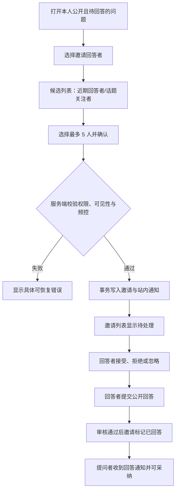
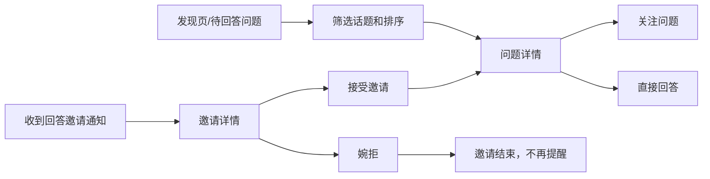

# 待回答问题发现与回答邀请闭环 PRD

> 状态：功能规划，具体实现状态以目标分支为准
> 适用对象：产品、前端、后端、测试与运营
> 本文描述产品需求，不代表功能已经实现。

## 1. 背景与目标

社区已有问题、回答、关注、通知和问题解决状态。当前仍缺少一个明确的供给闭环：提问者发布问题后，不容易找到合适的回答者；有经验的用户也缺少发现待回答问题的高效入口。

本功能让用户发现有价值且仍待回答的问题，并让问题作者邀请少量相关用户回答。回答者可以接受邀请、拒绝邀请或直接前往问题；回答发布后邀请自动完成，提问者随后可采纳答案。

### 1.1 目标

- 降低用户发现待回答问题的成本。
- 提高问题获得首个有效回答的比例，并缩短首答时间。
- 让邀请具备明确对象、状态、通知和频控，避免变成骚扰工具。
- 复用现有问题关注、话题关注、搜索、通知、答案采纳和公开可见性规则。

### 1.2 非目标

- 不做机器学习推荐或隐式用户画像。
- 不做群发、站内私信邀请、邮件邀请或邀请外链。
- 不改写现有 Feed 排序，不新建第二套问题/回答或通知事实表。
- 不承诺回答质量；邀请不是回答义务，也不代表平台背书。
- 不在本期建设复杂悬赏、积分奖励、专家认证或自动催答。

## 2. 用户与场景

| 用户 | 需求 | 成功结果 |
|---|---|---|
| 提问者 | 问题发布后没有回答，想邀请少数相关用户 | 发出邀请后能看到送达、接受/拒绝或回答状态 |
| 回答者 | 想发现自己能回答的问题，或收到相关邀请 | 可查看公开问题、接受/拒绝邀请，并快速进入回答编辑 |
| 社区读者 | 想浏览仍开放且缺少有效回答的问题 | 可按话题、时间和问题状态筛选，结果可翻页 |
| 管理员/审核员 | 处理滥用邀请或违规内容 | 可以依现有举报、审核和审计机制处理，不获得额外私密数据权限 |

## 3. 术语与业务规则

- **公开可见问题**：问题本身未删除、审核通过、可见，作者账号有效，且当前查看者有权访问；须复用项目现有统一可见性条件。
- **待回答问题**：公开可见且 `resolution_status = open`，并且当前没有公开可见、审核通过的回答。是否有被隐藏/删除回答不影响其“待回答”资格。
- **邀请**：问题作者对一个回答者发出的站内邀请记录。只有接收者可以接受或拒绝，作者可在接收者操作前撤回。
- **接受邀请**：回答者表示愿意查看并尝试回答。接受不产生回答、不承诺时限；接受后仍需主动发布回答。
- **完成邀请**：被邀请者在对应问题发布审核通过且公开的回答后，该邀请转为 `answered`。提交后待审核时先保持 `accepted`，审核通过后完成；被拒绝/隔离则保持可继续处理的 `accepted` 状态。
- 问题关闭或解决、问题被隐藏/删除、任一方账号禁用时，不允许新邀请；已有待处理邀请转为失效，不再显示操作入口。
- 任何邀请状态变更都需校验接收者/提问者权限、当前状态和目标问题公开状态；重复请求幂等。

## 4. 关键流程

### 4.1 提问者邀请回答



### 4.2 回答者发现与处理



## 5. 产品范围与优先级

### P0：MVP

- “待回答”发现列表：登录/游客均可浏览公开内容，登录用户可关注或回答。
- 话题筛选、最新排序、稳定游标分页；空列表、加载、失败和重试状态。
- 问题作者可从问题详情发出邀请；候选人使用确定性规则排序并显示推荐理由。
- 被邀请用户可在通知中心查看、接受、婉拒；邀请详情安全跳转至问题。
- 邀请记录、状态转换、通知和审计在同库事务中落库。
- 回答审核通过后自动完成对应邀请；问题状态或权限失效后关闭邀请操作。
- 建立频控、阻止/屏蔽过滤、接收偏好，以及必要的运营指标。

### P1：观察数据后再做

- “我发出的邀请”管理列表和撤回入口。
- 依据接受/回答情況优化候选人排序，但必须展示可理解的推荐原因。
- 每用户邀请接收偏好管理、话题维度的待回答提醒。
- 运营后台聚合邀请滥用率和待回答问题积压量。

### P2：本期不做

- 自动批量邀请、AI 代写邀请、付费悬赏、积分激励、邮件/推送通知。

## 6. 前端规格

### 6.1 待回答发现页

- 路由建议：`/questions/unanswered`。具体路由应避开现有 `/questions/:id` 动态路由冲突，放在动态路由前注册。
- 页面采用现有社区列表布局，不增加营销型首屏。
- 控件：话题筛选（默认全部）、排序（最新/待回答时长）、重置筛选；筛选项写入 URL，浏览器前进/后退可恢复。
- 条目：问题标题、摘要、作者、话题、发布时间、回答数/关注数和“待回答”状态；若问题存在非公开回答，不显示其内容或身份信息。
- 游标分页使用现有 `PageResult` 形状；加载更多时保持已有结果，过滤变化时清空并重新请求。
- 记录请求序号或取消过期请求，避免快速切换筛选时旧响应覆盖新列表。
- 状态：初次加载、无结果、网络错误（可重试）、无更多结果。

### 6.2 问题详情邀请入口

- 仅本人、问题公开、状态为 `open` 且无公开有效回答时显示“邀请回答”。
- 点击后打开对话框：候选用户头像/用户名、推荐理由、最近活跃/相关回答摘要（仅公开数据）、多选，最多 5 人。
- 不显示候选人的私人邮箱、在线状态、关注关系细节或非公开内容。
- 确认前说明一次将通知所选用户；按钮有提交中和防重复状态。
- 成功后显示邀请送达数量；部分失败时逐人说明原因，允许重新选择可用用户。
- 展示邀请状态：待处理、已接受、已婉拒、已回答、已撤回、已失效；P0 可只展示最近 20 条，不提供撤回管理。

### 6.3 邀请通知与收件箱

- 在现有通知列表增加“回答邀请”类型与明确文案：邀请者、问题标题、接受/婉拒/查看问题操作。
- 点击通知时服务端再次检查问题是否可见；已删除/隐藏目标显示安全占位文案，不泄露原正文。
- 接受/婉拒成功后乐观更新当前通知项；冲突时刷新状态并提示“邀请已失效或已处理”。
- 通知已读与邀请状态分离：打开通知不等于接受邀请。

### 6.4 移动端

- 375px 宽度下筛选控件换行不溢出，条目摘要可读，邀请选择器可滚动且底部操作固定可达。
- 键盘焦点可见；对话框支持 Escape 关闭；提交期间防止重复操作。

## 7. 后端 API 契约（建议）

沿用 `/api/v1`、JWT 中间件、统一响应封装、现有错误码和 cursor 格式。名称可按仓库路由命名调整，但语义保持一致。

| 方法与路径 | 登录 | 说明 |
|---|---|---|
| `GET /questions/unanswered` | 否 | 待回答问题列表；参数 `topic_id?`, `sort=latest\|oldest_unanswered`, `cursor?`, `limit?` |
| `GET /questions/:id/invitation-candidates` | 是 | 仅问题作者可取候选；参数 `q?`, `cursor?`, `limit?`；最多返回 20 人 |
| `POST /questions/:id/answer-invitations` | 是 | 问题作者邀请；body `{ "invitee_ids": ["..."] }`，单次最多 5 人 |
| `GET /me/answer-invitations` | 是 | 当前用户收到的邀请；参数 `status?`, `cursor?`, `limit?` |
| `POST /answer-invitations/:id/accept` | 是 | 接收者接受待处理邀请，幂等 |
| `POST /answer-invitations/:id/decline` | 是 | 接收者婉拒待处理邀请，幂等 |
| `DELETE /questions/:id/answer-invitations/:invitation_id` | 是 | P1；邀请者撤回未处理邀请 |

### 7.1 列表响应

```json
{
  "items": [
    {
      "question_id": "123",
      "title": "如何排查 Go 服务的连接池耗尽？",
      "excerpt": "目前观察到……",
      "author_id": "456",
      "author_name": "示例用户",
      "topics": [{ "topic_id": "7", "name": "Go" }],
      "answer_count": 0,
      "follower_count": 12,
      "create_time": "2026-11-20T10:00:00Z",
      "resolution_status": 0
    }
  ],
  "next_cursor": "opaque-cursor",
  "has_more": true
}
```

所有 ID 均按项目现有 JSON 约定作为字符串返回。实际字段以当前模型/API 兼容性核对结果为准。

### 7.2 候选规则

- 候选只来自有效账号，排除提问者本人、被提问者屏蔽/拉黑关系、已拒绝接收邀请的用户、问题作者已屏蔽用户及该问题已有未完成邀请的人。
- 公开确定性候选信号：回答过同一话题的问题、关注该话题、在该话题有近期公开回答。不可使用私信正文、私人历史或未经同意的敏感画像。
- 排序建议：同话题公开回答数（降序）→ 最近公开回答时间（降序）→ user_id（升序）。不因排序对外泄露精确行为统计；仅返回诸如“回答过该话题”这样的粗粒度解释。
- `q` 仅匹配公开用户名，不支持按邮箱或内部账号字段搜索。
- 若当前没有足够候选，不降低可见性和账号资格条件，返回较短列表。

### 7.3 状态码与业务错误

- `400`：参数格式错误、邀请人数超过 5、非法游标。
- `401`：需要登录。
- `403` 或项目统一的权限错误：非问题作者发邀请、非接收者操作邀请。
- `404`：问题/邀请不存在或对当前用户不可见；对不可见对象避免泄漏存在性。
- `409`：问题已回答/关闭、邀请已处理/失效、频控触发或目标用户不可邀请。
- 错误响应使用项目现有 envelope；不得把内部数据库错误文本返回客户端。

## 8. 数据模型与事务

建议新增 `question_answer_invitation` 表；具体表名遵循现有命名。所有 ID 使用项目 Snowflake 生成器，时间采用 UTC。

| 字段 | 类型/约束 | 说明 |
|---|---|---|
| `invitation_id` | bigint PK | 邀请 ID |
| `question_id` | bigint NOT NULL | 目标问题 |
| `inviter_id` | bigint NOT NULL | 问题作者 |
| `invitee_id` | bigint NOT NULL | 接收者 |
| `status` | tinyint NOT NULL | `0=pending, 1=accepted, 2=declined, 3=answered, 4=revoked, 5=expired` |
| `request_id` | varchar(64) NOT NULL | 请求追踪/幂等关联 |
| `expires_at` | datetime NOT NULL | 默认发送后 7 天 |
| `responded_at` | datetime NULL | 接收者响应时间 |
| `answered_at` | datetime NULL | 回答审核通过时间 |
| `create_time` / `update_time` | datetime | UTC 时间 |

- 索引：`(invitee_id, status, create_time, invitation_id)`、`(question_id, status, create_time)`、`(inviter_id, create_time)`。
- 需建立可靠的重复邀请约束。建议通过活跃邀请唯一性设计或事务锁，保证同一 `question_id + invitee_id` 同时最多一条有效邀请；历史终态记录仍可保留。
- 频控：每问题每 24 小时最多邀请 5 个不同用户；每邀请者每 24 小时最多发 20 条；对同一用户/问题 7 天内最多创建一次邀请。失败请求不占用配额。数值作为初始默认值，运营后可配置。
- 通知类型新增 `answer_invitation`；通知 payload 只保存邀请 ID 和问题 ID，不复制问题正文或用户隐私信息。
- 邀请与通知需要同事务写入；如现有通知写入已在数据库事务内可直接复用；跨服务投递仍走现有 outbox 机制。

### 8.1 发送事务

1. `SELECT question ... FOR UPDATE` 锁定问题。
2. 校验操作者是作者，问题公开、未解决、未关闭且没有公开有效回答。
3. 批量验证邀请对象有效、未屏蔽/拉黑、不在接收偏好拒绝名单，人数不超过上限。
4. 校验频控、重复活跃邀请与幂等键。
5. 插入邀请行和对应通知行；必要审计记录同事务写入。
6. 提交后返回每位接收者的结果；事务失败不留下部分邀请/通知。

### 8.2 接受/婉拒事务

- 对 invitation 行 `FOR UPDATE`，仅接收者可操作。
- 只允许 `pending` 转到 `accepted` 或 `declined`；同一终态重复操作返回成功，冲突状态返回 `409`。
- 同时复核问题和双方账号仍有效；问题失效则将邀请置为 `expired`，不可接受。
- 操作事实、状态变更、状态通知（如果产品配置需要）和审计必须同事务；初版只通知邀请者“接受/婉拒”，不提供额外邮件或推送。

### 8.3 回答完成联动

- 回答创建后仍遵守现有审核流程。仅当回答最终进入公开可见、审核通过状态，才把相同 `question_id + invitee_id` 的 `accepted` 邀请更新为 `answered`。
- 审核通过与邀请状态联动应在同一数据库事务；若审核变更链路不支持，则使用事务性 outbox，并实现重试幂等和补偿扫描。
- 作者删除/审核隐藏回答后，历史邀请仍为 `answered`，不自动重新提醒邀请者；若需要重开邀请由 P1 定义。

## 9. 权限、隐私与反滥用

- 公共待回答列表及搜索/候选均应用统一公开可见性条件；客户端过滤不构成访问控制。
- 被屏蔽或拉黑双方不能相互发起或接收新邀请；邀请创建后任一方建立屏蔽关系，待处理邀请立即失效。
- 用户设置增加 `answer_invite_enabled`，默认 `true`；关闭后不出现在候选、不能收到新邀请。开关关闭不影响已接受邀请的回答入口。
- 仅问题作者能发起/撤回；仅邀请接收者能接受/婉拒；管理员不能借普通用户接口代操作。
- 防枚举：不可见问题、禁用用户、被屏蔽候选统一返回不可用结果，不返回敏感拒绝原因。
- 审计字段：操作者、动作、问题/邀请 ID、request_id、时间、结果原因枚举；不得记录邀请正文、邮箱、token 或 IP 原文。
- 操作频控在服务端执行，支持代理/多实例环境；不可仅依赖浏览器按钮禁用。

## 10. 通知文案

| 事件 | 接收者 | 文案建议 | 跳转 |
|---|---|---|---|
| 邀请创建 | 回答者 | `{邀请者} 邀请你回答：{问题标题}` | 问题详情/邀请状态 |
| 接受邀请 | 提问者 | `{回答者} 接受了你的回答邀请` | 问题详情 |
| 婉拒邀请 | 提问者 | `{回答者} 婉拒了你的回答邀请` | 问题详情 |
| 被邀请回答审核通过 | 提问者 | `{回答者} 已回答你的问题` | 问题详情并定位回答 |
| 邀请过期/问题关闭 | 接收者 | 默认不额外推送；打开时显示“邀请已失效” | 安全问题占位或详情 |

通知不应暴露被邀请人名单给其他接收者。相同邀请重试不得重复通知。

## 11. 指标与事件

事件仅用于分析，不能替代关系表和邀请状态事实。

| 指标 | 定义 |
|---|---|
| 待回答列表点击率 | 有效列表曝光后进入问题详情的用户数 / 有效列表曝光用户数 |
| 邀请接受率 | 接受邀请数 / 已送达且未过期邀请数 |
| 邀请回答完成率 | 已回答邀请数 / 已接受邀请数 |
| 首答时间 | 问题创建时间至首条公开审核通过回答时间；按 UTC 统计中位数与 P75 |
| 7 日首答率 | 创建满 7 天且有公开有效回答的问题数 / 创建满 7 天的问题数 |
| 邀请投诉率 | 与邀请相关举报的邀请数 / 已送达邀请数 |

核心事件：`unanswered_list_view`、`unanswered_question_open`、`answer_invite_sent`、`answer_invite_accepted`、`answer_invite_declined`、`answer_invite_answered`。需定义用户/匿名会话、有效曝光阈值、去重口径、保留期限；上线前先采集 1 周基线，不预设未经验证的增长目标。

## 12. 验收标准

### 功能

- 游客能浏览公开待回答问题；隐藏、删除、待审问题不会出现在列表或候选。
- 公开回答、关闭或解决后问题从待回答列表移除；隐藏回答不让问题误显示为已回答。
- 作者可一次邀请 1–5 人；非作者不能发送或查看收件人名单。
- 接收者能接受/婉拒；其他用户不能代操作；重复操作幂等，过期/失效状态有明确反馈。
- 邀请接受不自动创建回答；公开审核通过的回答会将邀请置为 `answered`。
- 双方屏蔽、用户关闭邀请接收、问题状态变化后，邀请操作按本 PRD 失效规则执行。
- URL 筛选与浏览器历史同步；桌面及 375px 移动端布局无溢出。

### 后端与数据

- 迁移从空库与前一迁移版本可顺序执行；重复迁移行为符合现有迁移器约定。
- 并发邀请同一人只有一条活跃邀请；达到频控的并发请求不超额。
- 邀请/通知/审计原子性通过故障注入验证；任意写入失败均无半成品状态。
- 状态竞争（接受 vs 婉拒、接受 vs 撤回、回答审核 vs 邀请过期）结果确定且有集成测试。
- 游标绑定过滤条件、排序与用户范围；非法/跨用户游标拒绝，跨页无重复漏项。
- 公开可见性与屏蔽规则通过列表、搜索、候选、详情旁路测试。

### 浏览器验收

- 待回答列表：筛选、排序、加载更多、空态、错误重试、前进/后退。
- 邀请：选择 0/1/5/6 人边界、重复提交、部分失效、权限失败。
- 通知：接受、婉拒、已读与状态独立、失效问题安全占位。
- 375px：导航到待回答列表、筛选、打开候选对话框、键盘/滚动、提交成功。

## 13. 分阶段交付与依赖

| 阶段 | 范围 | 完成证据 |
|---|---|---|
| 0. 基线核对 | 在目标开发分支核对路由、通知、屏蔽、统一可见性、迁移和 UI 组件 | API/表/权限映射表；确认迁移编号和依赖现状 |
| 1. 后端基础 | 迁移、候选和待回答查询、邀请状态机、事务通知、频控 | DAO/logic/handler 集成测试，真实 MySQL 并发用例 |
| 2. 前端 MVP | 待回答页、详情邀请器、通知操作、移动端 | Build + API contract + Playwright 用户流程 |
| 3. 灰度与观察 | 小流量启用、指标仪表、举报反馈和限流调节 | 7 天指标基线、错误率/滥用率复盘 |

依赖：现有用户/话题关注与屏蔽、统一公开可见性、通知写入、回答审核状态变更、问题解决状态、游标分页。任一依赖缺失时先补依赖，不得在新功能里重复实现另一套规则。

## 14. 开发任务拆分

### 后端

- `BE-01`：创建邀请表迁移、模型常量与 DAO；状态枚举及终态约束。
- `BE-02`：待回答公开列表查询，支持话题过滤、稳定排序、keyset cursor。
- `BE-03`：候选用户查询与理由字段；遵守公开可见、屏蔽和偏好规则。
- `BE-04`：批量发送邀请事务、幂等、频控、邀请通知与审计。
- `BE-05`：收件箱分页、接受/婉拒、冲突错误映射。
- `BE-06`：回答审核通过联动完成邀请；问题状态/屏蔽/账号状态失效处理。
- `BE-07`：真实 MySQL 集成测试、迁移链、并发与可见性矩阵。

### 前端

- `FE-01`：API 类型和请求封装；复用分页和错误处理组件。
- `FE-02`：待回答列表页、筛选 URL、键集分页和响应竞态防护。
- `FE-03`：问题详情邀请入口、候选选择器和频控错误显示。
- `FE-04`：通知类型、接受/婉拒交互、状态刷新和安全占位。
- `FE-05`：375px/桌面 Playwright 验收及截图留档。

## 15. 上线门槛

- 所有 P0 功能和权限测试通过；任何公开内容绕过统一可见性条件均阻止发布。
- 邀请发送必须可限流、可审计、可按配置整体关闭。
- 指标事件不含敏感个人信息；通知失败不能造成邀请事实丢失。
- 灰度开关初始关闭；按 10% 登录用户开启观察 7 天，再由产品负责人根据首答率、接受率、投诉率决定扩大或回滚。
- 灰度期间任何被确认的批量骚扰、越权邀请或内容泄露立即关闭开关并调查。

## 16. 待产品确认项

1. “接受邀请”是否需要明确操作，还是点开问题就视作接受？本 PRD 建议保留显式接受，以便用户表达意愿，打开通知只标已读。
2. 7 天过期、同问题最多 5 人/日、每人 20 人/日的初始频控是否合适？上线前需结合社区规模调整。
3. 待回答定义是否要包括“已有回答但尚未采纳”的问题？本期定义为没有公开有效回答；解决状态由采纳闭环处理。
4. 候选人是否默认只来自同话题公开活跃用户？本期建议如此，不启用邮箱、私信或外部触达。
5. 接受/婉拒状态是否通知问题作者？本期建议通知，但可在通知设置中关闭非必要邀请动态。
